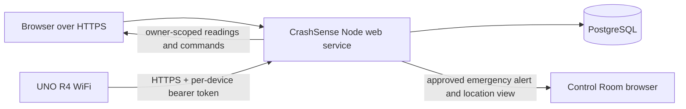

# CrashSense architecture

## Public multi-user service

The Node service hosts the static dashboard and handles account registration, password login, sessions, device enrollment, telemetry, and commands. PostgreSQL stores users, hashed sessions, per-user device ownership, hashed device tokens, each device's latest telemetry, and its command queue. Regular accounts can read or command only their own devices.

The separate `/control-room.html` page is for administrator-approved accounts listed in `CRASH_SENSE_CONTROL_ROOM_USERS`. Its API returns only devices with a current `EMERGENCY_ALERT`, plus the incident summary and reported location. It does not return ordinary telemetry or device-owner account details. Approval grants global visibility across registered devices and must be restricted to trusted control-room operators.

The user creates a device from the dashboard. The service displays a random per-device token once; firmware stores that token in a local, Git-ignored `cloud_secrets.h` and sends telemetry to the same HTTPS service. The token hash maps each board request to its registered device. The firmware continues to serve its local HTTP page separately.

## Telemetry privacy

Every owner dashboard data route requires a valid account session and an owned device ID. General telemetry omits exact GPS; the separate location route returns coordinates only after the same owner check. The Control Room route additionally requires an administrator-approved username and filters results to emergency alerts only. Device tokens are stored as SHA-256 hashes and never returned again after enrollment. Passwords use per-user salt and Node.js `scrypt`; sessions are random HTTP-only cookies stored by hash in PostgreSQL.

## Runtime components

The `simulator/` directory name is retained because the existing Render web service uses it as its root directory. The deployed server only uses `server.js`, `src/database.js`, and the files in `public/`. The background car uses the bundled Three.js library and keyboard/mouse input; it does not synthesize sensor readings or crash alerts.

## Limits

- Account email verification, password recovery, MFA, organization-based device groups, billing, and abuse moderation are not implemented. Control Room approval is managed through a server environment-variable allowlist. Add verified recovery and abuse controls before commercial use.
- The UNO R4's synchronous HTTPS publisher can pause its loop during network activity. This prototype is not certified for vehicle safety or emergency dispatch.
- PostgreSQL must use persistent storage. On Render, connect the web service and database in the same region and use the internal database URL.
