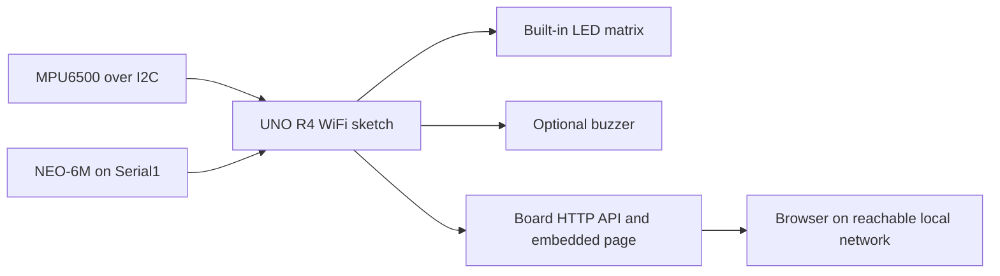
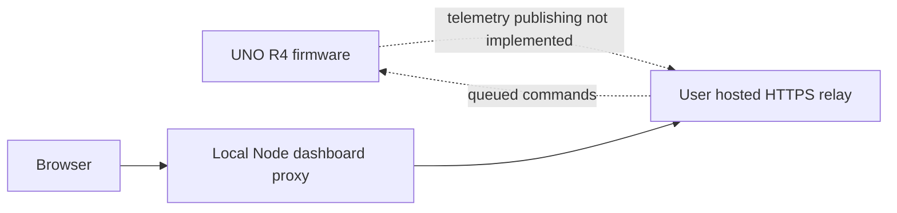

# CrashSense architecture

## Current R4 path

The firmware samples motion, evaluates impact and rollover conditions, manages a driver countdown, and serves `/api/data`, `/api/cancel`, and `/api/reset` over its local HTTP server.

## Cloud relay template (device integration pending)

`cloud_server/` implements authenticated telemetry receive, latest-reading fetch, and queued `cancel`/`reset` commands. The laptop Node server proxies dashboard reads and commands. The board sketch still uses only its local API and does not post telemetry or retrieve cloud commands, so different-network operation is incomplete.

The laptop server removes coordinates, speed, and map URLs from public vehicle status. Named users configured in `CRASH_SENSE_LOCATION_USERS` can sign in for private GPS details; cancellation/reset commands require a signed-in session. Host the dashboard behind HTTPS when exposing it beyond localhost.

The UNO R4 local HTTP API also omits exact coordinates and map links. Once cloud publishing is implemented, authenticated dashboard users can retrieve precise location through the private dashboard endpoint.

## Legacy simulator

`simulator/src/` retains older synthetic sensor, detector, GPS, mock modem, and alert code as unused legacy files. The current `simulator/server.js` does not import or start them; its live routes do not substitute generated readings.

## Limits

- Use HTTPS for public relay traffic and separate private device/dashboard tokens.
- Keep the dashboard token in the laptop server environment, never browser code.
- Relay readings and commands are in memory and are lost on relay restart.
- Cloud polling cadence, retries, persistence, and firmware TLS behavior remain to be implemented and reviewed.
- This prototype is not certified for vehicle safety or emergency dispatch.
