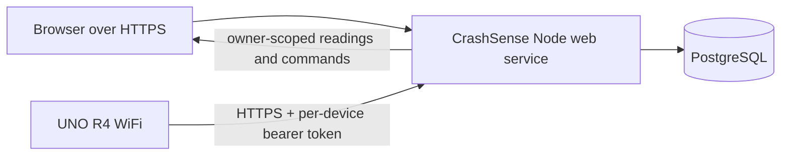

# CrashSense architecture

## Public multi-user service

The Node service hosts the static dashboard and handles account registration, password login, sessions, device enrollment, telemetry, and commands. PostgreSQL stores users, hashed sessions, per-user device ownership, hashed device tokens, each device's latest telemetry, and its command queue. No account can read or command another account's devices.

The user creates a device from the dashboard. The service displays a random per-device token once; firmware stores that token in a local, Git-ignored `cloud_secrets.h` and sends telemetry to the same HTTPS service. The token hash maps each board request to its registered device. The firmware continues to serve its local HTTP page separately.

## Telemetry privacy

Every dashboard data route requires a valid account session and an owned device ID. General telemetry omits exact GPS; the separate location route returns coordinates only after the same owner check. Device tokens are stored as SHA-256 hashes and never returned again after enrollment. Passwords use per-user salt and Node.js `scrypt`; sessions are random HTTP-only cookies stored by hash in PostgreSQL.

## Legacy components

`cloud_server/` is the former single-device in-memory relay. The public multi-user app does not depend on it. `simulator/src/` still contains older sensor and modem simulation modules, but the current server does not import them or generate telemetry.

## Limits

- Account email verification, password recovery, MFA, organizations, billing, and abuse moderation are not implemented. Add verified recovery and abuse controls before commercial use.
- The UNO R4's synchronous HTTPS publisher can pause its loop during network activity. This prototype is not certified for vehicle safety or emergency dispatch.
- PostgreSQL must use persistent storage. On Render, connect the web service and database in the same region and use the internal database URL.
