# CrashSense: Systems Engineering & Software Architecture

**Project:** CrashSense — Intelligent Accident Detection, Location Tracking, and Emergency Alert System  
**Document Version:** 1.0.0  
**Status:** Approved & Implemented  

---

## 1. Architectural Philosophy & Design Principles

CrashSense is engineered as an embedded, fail-safe automotive telematics system designed around three core principles:
1. **Multi-Stage False-Alarm Suppression:** A single accelerometer threshold is strictly prohibited. Vehicular collisions exhibit distinct physical signatures: high-G impulse, violent jerk ($da/dt$), high rotational tumble ($\omega$), and either sustained post-impact rest or severe attitude rollover.
2. **Deterministic, Non-Blocking Execution:** The embedded firmware utilizes time-sliced cooperative polling loops without blocking `delay()` calls, ensuring the user cancellation button and acoustic warning buzzer remain responsive even during sensor acquisition or cellular modem transactions.
3. **Hardware-Decoupled Simulation Parity:** The algorithmic detection pipeline, state machine transitions, and emergency formatting logic are implemented in parallel within both the embedded C++ ESP32 firmware and the Node.js PC Simulator, enabling comprehensive bench testing before hardware deployment.

---

## 2. Complete State Machine

The master alert coordinator implements a finite state machine (FSM) with explicit transition guards and timeout boundaries:

```mermaid
stateDiagram-v2
    [*] --> STATE_IDLE: Boot & Hardware Calibration

    STATE_IDLE --> STATE_CANDIDATE: Peak Accel >= 3.2g OR Jerk >= 18g/s
    STATE_IDLE --> STATE_SENSOR_FAULT: I2C Disconnect / NaN Readings

    STATE_CANDIDATE --> STATE_IDLE: Transient Impulse Dismissed (Pothole / Brake)
    STATE_CANDIDATE --> STATE_COUNTDOWN: Collision Kinematics Confirmed (High-G + Gyro + Inactivity)

    STATE_COUNTDOWN --> STATE_CANCELLED: Driver presses Button (Physical / Simulator)
    STATE_COUNTDOWN --> STATE_ALERT_PENDING: Countdown Window Expires (Default: 15s)

    STATE_CANCELLED --> STATE_IDLE: Reset & Return to Monitoring

    STATE_ALERT_PENDING --> STATE_SENDING: Packet Composed (GPS Fix / Last Known)
    STATE_SENDING --> STATE_SENT: Modem returns +CMGS: <ref> & OK
    STATE_SENDING --> STATE_FAILED: Retries Exhausted (Modem Offline / Unregistered)

    STATE_SENT --> STATE_IDLE: Post-Incident Cooldown Complete
    STATE_FAILED --> STATE_IDLE: Incident Logged; System Restores Monitoring
    STATE_SENSOR_FAULT --> STATE_IDLE: Sensor Reconnected & Re-initialized
```



---

## 3. Mathematical Accident Classification Model

### A. Instantaneous Acceleration Magnitude
Linear acceleration is measured across three orthogonal axes by the MPU-6050 accelerometer:
$$a_{\text{magnitude}} = \sqrt{a_x^2 + a_y^2 + a_z^2}$$
- **Units:** Standard gravitational units ($1g \approx 9.80665 \text{ m/s}^2$).
- **Gravity Baseline:** When level and stationary, $a_x = 0, a_y = 0, a_z = 1.0g$, yielding $a_{\text{magnitude}} = 1.00g$.
- **Collision Peak Threshold ($T_{\text{accel}}$):** Configured at $3.20g$ (nominal vehicular collision threshold).

### B. Linear Jerk Rate ($\text{d}a/\text{d}t$)
Jerk represents the time rate of change of the acceleration vector:
$$\text{Jerk} = \frac{|a_{\text{magnitude}}(t) - a_{\text{magnitude}}(t - \Delta t)|}{\Delta t}$$
- **Units:** $g/\text{s}$.
- Automotive collisions typically exceed $18.0g/\text{s}$ to $40.0g/\text{s}$. Steady acceleration or hard braking produces smooth changes ($< 6.0g/\text{s}$).

### C. Gyroscopic Rotational Rate Magnitude
Angular velocity is measured across three axes:
$$\omega_{\text{magnitude}} = \sqrt{\omega_x^2 + \omega_y^2 + \omega_z^2}$$
- **Units:** Degrees per second ($\text{deg/s}$).
- Real-world crashes, spinouts, and side impacts produce high rotational rates ($\ge 150^\circ/\text{s}$). Potholes, speed bumps, and dropped devices have minimal yaw/pitch/roll rotational momentum.

### D. Vehicle Attitude (Pitch & Roll) & Rollover Criteria
Orientation is derived from the static gravity vector:
$$\text{Pitch} = \arctan\left(\frac{a_x}{\sqrt{a_y^2 + a_z^2}}\right) \times \frac{180}{\pi}$$
$$\text{Roll} = \arctan\left(\frac{a_y}{\sqrt{a_x^2 + a_z^2}}\right) \times \frac{180}{\pi}$$
- **Rollover Condition:** $\Delta\text{Roll} \ge 45.0^\circ$ sustained after a dynamic shock event.

### E. Multi-Stage Verification Logic Summary

```
                      +-----------------------------+
                      | Continuous Telematics (50Hz)|
                      +-----------------------------+
                                     |
                                     v
                        Is Sensor Online and Valid?
                       /                           \
                     No                             Yes
                     v                               v
           [ SENSOR_FAULT ]           Magnitude >= 3.2g OR Jerk >= 18g/s?
                                     /                                  \
                                   No                                    Yes
                                   v                                      v
                          [ NORMAL_DRIVING ]                   [ CANDIDATE TRIGGERED ]
                                                                          |
                                                                          v
                                                          Evaluate Post-Impact Window:
                                                          - Pothole: < 120ms shock, low gyro
                                                          - Hard Brake: Pure Ax, low gyro
                                                          - Crash: Accel >= 3.2g + Gyro >= 150°/s
                                                          - Rollover: Roll Delta >= 45°
                                                               /                   \
                                                     False Alarm                   Confirmed
                                                          v                            v
                                                    [ DISMISSED ]             [ ACTIVE COUNTDOWN ]
                                                                               (Buzzer Active)
                                                                               /             \
                                                                       Button Pressed    Timeout Expired
                                                                             v                 v
                                                                       [ CANCELLED ]      [ SMS DISPATCH ]
```

---

## 4. Subsystem Module Breakdown

### 1. `MPU6050_Driver`
- Hardware interface to InvenSense MPU-6050 over $I^2C$ bus at $400\text{kHz}$.
- Configures full-scale ranges ($\pm 8g$ accelerometer, $\pm 2000^\circ/\text{s}$ gyroscope).
- Computes baseline zero-offset calibration during stationary vehicle boot.
- Converts raw 16-bit counts into floating-point physical units ($g$, $\text{deg/s}$).

### 2. `AccidentDetector`
- Multi-stage pipeline evaluating peak magnitude, jerk, angular velocity, and vehicle attitude.
- Rejects false alarms caused by potholes, speed bumps, sudden braking, and sharp cornering.
- Classifies telemetry into: `NORMAL_MOVEMENT`, `POSSIBLE_IMPACT`, `FALSE_ALARM`, `SUSPECTED_ACCIDENT`, `HIGH_SEVERITY_CANDIDATE`, and `SENSOR_FAULT`.

### 3. `GPSManager`
- High-integrity NMEA-0183 parser for u-blox NEO-6M receiver.
- Decodes `$GPRMC` and `$GPGGA` sentences with strict XOR checksum validation.
- Tracks satellite count, HDOP, fix validity, and fix age.
- Employs safe fallback to timestamped last known location when GPS signal is obstructed (tunnels/garages). Never fabricates `0.0, 0.0` coordinates.

### 4. `SIM7600_Modem`
- AT-command state machine communicating with SIMCOM SIM7600 4G LTE modem over UART.
- Handles modem startup (`AT`, `ATE0`), SIM check (`AT+CPIN?`), network registration (`AT+CREG?`), and signal strength (`AT+CSQ`).
- Dispatches emergency SMS messages in text mode (`AT+CMGF=1`, `AT+CMGS`).
- Implements bounded retries (maximum 3 attempts) and non-blocking timeout handling.
- Synthesizes mock voice escalation for development safety.

### 5. `AlertManager`
- Master orchestrator governing system states, the 15-second driver countdown window, and deduplication cooldown.
- Drives active piezo buzzer pulses and status LED flash patterns.
- Listens for debounced push-button false-alarm cancellations.

### 6. `SerialTestRunner`
- Interactive Serial Monitor CLI enabling developers and academic evaluators to inject synthetic collisions (`CRASH`), rollovers (`ROLLOVER`), braking events (`BRAKE`), and potholes (`POTHOLE`) without physical collision rigs.
