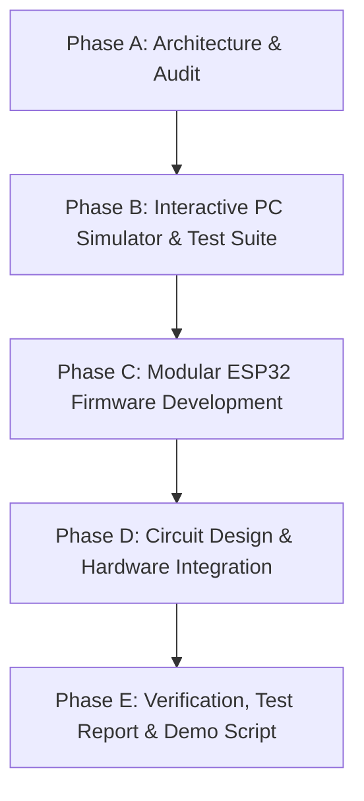

# CrashSense: Master Implementation Plan

**Project:** CrashSense — Intelligent Accident Detection, Location Tracking, and Emergency Alert System  
**Document Version:** 1.0.0  
**Status:** Approved & In Execution  
**Lead Engineer:** Senior Embedded Systems & IoT Architect  

---

## 1. Project Overview & Milestones

CrashSense is engineered as an end-to-end mission-critical telematics system consisting of two primary software artifacts:
1. **The PC Telematics Simulator & Test Suite (Phase B):** A full-featured desktop/browser environment with interactive physics controls, live gauges, mock GNSS/4G modem, and automated verification of all 17 crash scenarios.
2. **The ESP32 Production Firmware (Phase C & D):** An embedded C++ firmware suite implementing hardware abstraction for MPU-6050, NEO-6M, and SIM7600 with an interactive Serial mock injection mode and non-blocking state machine.

---

## 2. Phase-by-Phase Roadmap

### Phase A: Architecture, Audit & Environment Baseline (Completed)
- [x] Inspect local system environment and toolchains.
- [x] Establish Git version control repository.
- [x] Produce `PROJECT_AUDIT.md` (hardware BOM, pinouts, power risks, crash math).
- [x] Produce `IMPLEMENTATION_PLAN.md` (detailed task breakdown and test matrix).

### Phase B: PC Simulator & Automated Scenario Suite
- [ ] Initialize Node.js simulator project with `package.json` and zero-dependency core.
- [ ] Implement `src/sensorEngine.js` for simulating physics (linear acceleration, angular velocity, jerk, roll, tilt).
- [ ] Implement `src/detector.js` with multi-stage crash classification:
  - Magnitude: $a_{\text{mag}} = \sqrt{a_x^2 + a_y^2 + a_z^2}$
  - Jerk rate: $\Delta a / \Delta t$
  - Gyroscope rate: $\omega_{\text{mag}} = \sqrt{\omega_x^2 + \omega_y^2 + \omega_z^2}$
  - Post-impact stationary and attitude rollover confirmation
- [ ] Implement `src/gpsEngine.js` with NMEA parsing, satellite acquisition delay, fix age tracking, and Google Maps URL generation.
- [ ] Implement `src/modemEngine.js` with SIM7600 AT command emulation (`AT`, `AT+CREG?`, `AT+CSQ`, `AT+CMGS`, `ATD`, retries, network drop).
- [ ] Implement `src/alertManager.js` state machine (`IDLE` $\to$ `CANDIDATE` $\to$ `COUNTDOWN` $\to$ `ALERT_PENDING` $\to$ `SENDING` $\to$ `SENT` / `FAILED` / `CANCELLED`).
- [ ] Implement `src/emergencyLookup.js` for mock nearby hospital / ambulance dispatch lookup.
- [ ] Build interactive Web Dashboard (`public/index.html`, `public/style.css`, `public/app.js`):
  - Real-time gauges for 3-axis accelerometer and gyroscope.
  - Interactive scenario triggers: Normal Driving, Pothole/Bump, Hard Braking, Sharp Turn, Severe Crash, Rollover, Sensor Fault.
  - Live cancellation countdown with acoustic buzzer feedback.
  - Interactive Mock Modem terminal displaying AT command transactions.
  - Live Map preview with coordinates and fix age.
  - Incident log viewer with JSON Lines and CSV export.
- [ ] Implement automated test runner (`tests/runner.js`) and execute tests for all 17 required scenarios.

### Phase C: Modular ESP32 Firmware
- [ ] Configure `platformio.ini` with ESP32 DevKit V1 board settings and dependencies.
- [ ] Implement `include/config.h` with pin definitions, default thresholds, timings, and serial debug settings.
- [ ] Implement `include/types.h` with system structs, telemetry frames, and enum state definitions.
- [ ] Implement `MPU6050_Driver.h` / `.cpp` with $I^2C$ initialization, self-test, calibration offsets, and raw-to-$g$ conversion.
- [ ] Implement `AccidentDetector.h` / `.cpp` matching the validated simulator detection logic.
- [ ] Implement `GPSManager.h` / `.cpp` with TinyGPS++ / NMEA custom parsing, fix age checks, and stale detection.
- [ ] Implement `SIM7600_Modem.h` / `.cpp` with non-blocking AT command state machine, timeout guards, signal strength monitoring, SMS dispatch, and call simulation.
- [ ] Implement `AlertManager.h` / `.cpp` for overall state coordination, active buzzer beeping, and push-button interrupt handling.
- [ ] Implement `SerialTestRunner.h` / `.cpp` allowing developers to inject simulated crash data over USB Serial Monitor (`TRIGGER_CRASH`, `BRAKE`, `POTHOLE`, `CANCEL`) without physical crash equipment.
- [ ] Implement `src/main.cpp` orchestrating all modules with deterministic timing and non-blocking delays.

### Phase D: Hardware Integration, Circuitry & Pin Mappings
- [ ] Write `CIRCUIT_AND_PIN_MAPPING.md` with complete connection tables, wire color coding, pull-ups, and level shifting rules.
- [ ] Write `HARDWARE_SETUP.md` with power supply architecture (buck converter, capacitor decoupling), SIM card preparation, and antenna placement.
- [ ] Write `ARCHITECTURE.md` detailing the software state machine, dataflow, and telemetry packet structures.
- [ ] Write `SIMULATION_GUIDE.md` explaining how to launch the simulator, trigger events, and inspect logs.
- [ ] Write `TROUBLESHOOTING.md` covering common failure modes (I2C bus errors, SIM7600 brownouts, GPS cold-start, AT command timeouts).

### Phase E: Validation, Test Report & Demo Script
- [ ] Run full automated test suite and capture all results.
- [ ] Compile comprehensive `TEST_REPORT.md` with pass/fail matrix, synthetic test limits, and real-world safety notes.
- [ ] Generate `.env.example` with configuration variables.
- [ ] Prepare `README.md` with high-level summary, architecture diagram, startup guide, and deployment instructions.
- [ ] Produce an academic/demonstration presentation script tailored for project reviews and professor evaluation.

---

## 3. Scenario Verification Matrix (Section 7 Requirements)

| # | Scenario / Test Case | Primary Conditions | Expected System Response | Verification Method |
|---|---|---|---|---|
| 1 | **Normal Movement** | $a < 1.4g$, $\omega < 50^\circ/\text{s}$ | State remains `IDLE`. No alert triggered. | Automated Test & GUI |
| 2 | **Sudden Braking** | $a_x \approx -1.5g$, jerk moderate, no angular spike | Candidate evaluated; dismissed after stationary check. | Automated Test & GUI |
| 3 | **Pothole or Bump** | $a_z$ spike $2.2g$ ($< 100\text{ms}$), driving continues | Evaluated as false alarm; dismissed. | Automated Test & GUI |
| 4 | **Sharp Turn** | $a_y \approx 1.2g$, $\omega_z \approx 70^\circ/\text{s}$ | Evaluated; no collision detected from lateral turn alone. | Automated Test & GUI |
| 5 | **Simulated Severe Impact** | $a > 3.8g$, jerk $> 20g/\text{s}$, $\omega > 180^\circ/\text{s}$ | High-severity candidate confirmed; countdown starts; buzzer sounds. | Automated Test & GUI |
| 6 | **Button Pressed During Countdown** | Severe impact followed by driver button click | Countdown halts; state $\to$ `CANCELLED`; event logged. | Automated Test & GUI |
| 7 | **Countdown Expires** | Severe impact; no cancellation within timeout | State $\to$ `ALERT_PENDING`; emergency transmission starts. | Automated Test & GUI |
| 8 | **GPS Has No Fix** | GPS module searching satellites ($0$ sats) | Alert dispatched with explicit status `GPS: NO_FIX`. | Automated Test & GUI |
| 9 | **GPS Fix is Stale** | Fix age $> 120\text{ seconds}$ | Alert dispatched with `LAST_KNOWN_LOCATION` and explicit age tag. | Automated Test & GUI |
| 10 | **Modem Unavailable** | UART communication fails or SIM missing | Modem failure logged; retry bounded; fallback logged. | Automated Test & GUI |
| 11 | **SMS Succeeds** | Modem returns `+CMGS: <ref>` and `OK` | SMS status marked `SENT`; reference ID stored. | Automated Test & GUI |
| 12 | **SMS Fails** | Modem returns `+CMS ERROR` | SMS marked `FAILED`; bounded retry scheduled; logged. | Automated Test & GUI |
| 13 | **Repeated Trigger** | Continuous high vibration after impact | Deduplication & cooldown logic prevents duplicate alerts. | Automated Test & GUI |
| 14 | **Restart During Incident** | System reset during active countdown or sending | State recovery loads safe default; logs reset anomaly. | Automated Test & GUI |
| 15 | **Network Returns** | Cell signal restored after temporary outage | Pending alert transmits cleanly without duplicates. | Automated Test & GUI |
| 16 | **Sensor Disconnected** | I2C read returns bus error or NaN | System enters `SENSOR_FAULT`; sounds diagnostic beeps; no crash alert. | Automated Test & GUI |
| 17 | **Emergency Service Lookup** | Valid GPS location available | Discovers mock nearby hospitals & ambulance dispatch with timestamps. | Automated Test & GUI |

---

## 4. Immediate Next Step

Proceed directly to **Phase B**:
1. Create `simulator/package.json` and configure dependencies.
2. Build the simulation engine core (`sensorEngine`, `detector`, `gpsEngine`, `modemEngine`, `alertManager`, `emergencyLookup`).
3. Build the web dashboard interface (`index.html`, `style.css`, `app.js`).
4. Write and execute the automated test runner for all 17 scenarios.
