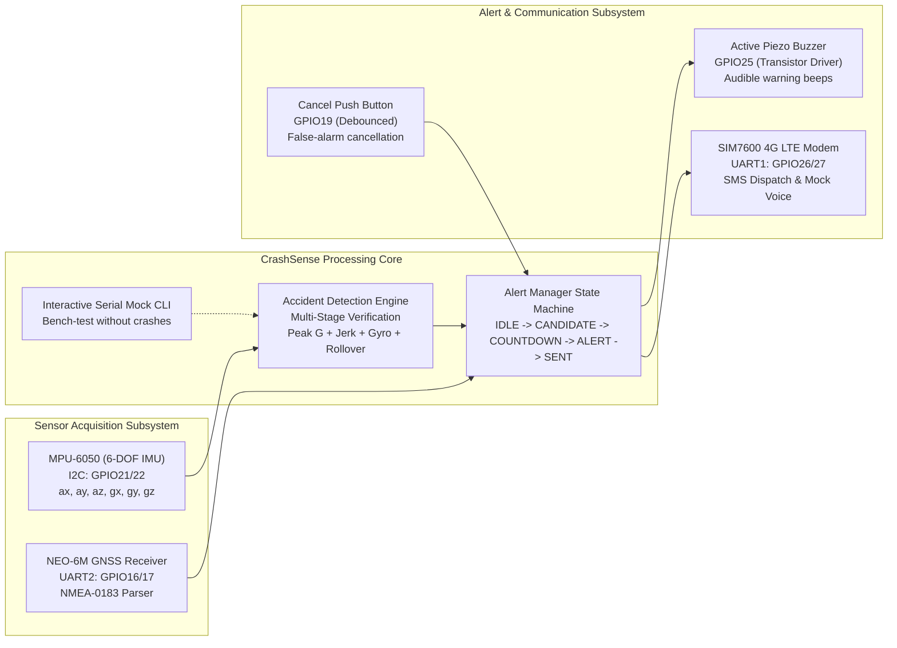

# CrashSense: AI-Assisted Accident Detection, Tracking & Alert System

[](file:///./ARCHITECTURE.md)
[](file:///./TEST_REPORT.md)
[](file:///./CIRCUIT_AND_PIN_MAPPING.md)
[](file:///./SIMULATION_GUIDE.md)

---

## 1. System Overview

**CrashSense** is a comprehensive, production-grade automotive telematics and IoT emergency response system. It detects vehicular collisions using 6-DOF inertial measurements, eliminates false alarms through multi-stage kinematic verification and an interactive driver cancellation window, acquires GNSS satellite coordinates, and dispatches real-time emergency telemetry over 4G LTE cellular modems and web interfaces.

The project provides dual-target parity:
1. **Interactive PC Simulator & Automated Test Suite:** A high-fidelity browser cockpit dashboard with Web Audio synthesized buzzer beeps, live physics scenario injectors, mock GNSS/SIM7600 modems, and an automated verification runner testing all 17 required scenarios.
2. **Modular ESP32 Embedded Firmware:** Production-ready C++ firmware adhering to non-blocking state machines, hardware abstraction for MPU-6050, NEO-6M, and SIM7600, with an interactive USB Serial mock injection console for hardware bench evaluation.



---

## 2. Multi-Stage Accident Detection Mathematical Model

To eliminate false alarms caused by potholes, speed bumps, hard braking, or dropped devices, CrashSense evaluates collisions through a multi-stage physical criteria pipeline:

1. **Continuous Baseline Acquisition:**
   - 50 Hz telematics sampling loop.
   - Calculates 3-axis acceleration magnitude:
     $$a_{\text{mag}} = \sqrt{a_x^2 + a_y^2 + a_z^2}$$
     *(Standard gravitational units: $1.0g \approx 9.80665 \text{ m/s}^2$ when level and stationary).*

2. **Kinematic Jerk Assessment:**
   $$\text{Jerk} = \frac{|a_{\text{mag}}(t) - a_{\text{mag}}(t - \Delta t)|}{\Delta t}$$
   - True collisions exceed $18.0g/\text{s}$. Hard braking produces smooth deceleration ($< 6.0g/\text{s}$).

3. **Rotational Gyroscopic Tumble:**
   $$\omega_{\text{mag}} = \sqrt{\omega_x^2 + \omega_y^2 + \omega_z^2}$$
   - Severe collisions and spinouts generate violent rotational rates ($\ge 150.0^\circ/\text{s}$). Potholes and speed bumps induce vertical shock with negligible rotational momentum.

4. **Vehicle Attitude & Rollover Confirmation:**
   $$\text{Roll} = \arctan\left(\frac{a_y}{\sqrt{a_x^2 + a_z^2}}\right) \times \frac{180}{\pi}$$
   - Permanent attitude shift ($\Delta\text{Roll} \ge 45.0^\circ$) triggers immediate high-severity rollover classification.

5. **Driver Fail-Safe Cancellation Window:**
   - Suspected collisions trigger a configurable 15-second countdown.
   - Active buzzer sounds loud warning beeps.
   - If the driver presses the physical button (or dashboard cancel button), the event is marked `CANCELLED_BY_USER`, cellular transmission is aborted, and the false alarm is logged.

---

## 3. Hardware Bill of Materials & Pin Configuration

| ESP32 GPIO | Subsystem / Component | Component Pin | Electrical Mode | Recommended Wire Color | Functional Role |
|---|---|---|---|---|---|
| **GPIO 21** | MPU-6050 IMU | **SDA** | $I^2C$ Data (Open-Drain) | **Yellow** | Default $I^2C$ Data line ($4.7\text{k}\Omega$ pull-up to 3.3V). |
| **GPIO 22** | MPU-6050 IMU | **SCL** | $I^2C$ Clock (Open-Drain)| **Green** | Default $I^2C$ Clock line ($400\text{kHz}$ Fast Mode). |
| **GPIO 16** | NEO-6M GPS | **TXD** (GPS Tx $\to$ ESP32 Rx) | UART2 Rx (3.3V CMOS) | **White** | Hardware Serial2 Rx. Receives NMEA stream at 9600 baud. |
| **GPIO 17** | NEO-6M GPS | **RXD** (GPS Rx $\leftarrow$ ESP32 Tx)| UART2 Tx (3.3V CMOS) | **Orange** | Hardware Serial2 Tx. Transmits GPS configuration commands. |
| **GPIO 26** | SIM7600 4G LTE | **TXD** (Modem Tx $\to$ ESP32 Rx) | UART1 Rx (Level-Shifted)| **Blue** | Hardware Serial1 Rx. Receives AT command replies. |
| **GPIO 27** | SIM7600 4G LTE | **RXD** (Modem Rx $\leftarrow$ ESP32 Tx)| UART1 Tx (Level-Shifted)| **Purple** | Hardware Serial1 Tx. Transmits AT commands at 115200 baud. |
| **GPIO 25** | Active Buzzer | **Transistor Base** | Digital Output | **Brown** | Drives 2N2222 NPN switching 5V buzzer. |
| **GPIO 19** | Push Button | **Switch Terminal** | Digital Input (`INPUT_PULLUP`)| **Gray** | Driver cancellation button (active LOW). |
| **GPIO 2** | Status LED | **On-Board LED** | Digital Output | *Internal* | Visual heartbeat and state blinker. |
| **VIN** | Power Supply | **5V Input** | Power Rail ($\ge 2.5\text{A}$) | **Red** | Regulated 5V from DC-DC buck converter. |
| **GND** | Ground Plane | **Common Ground** | Common Reference | **Black** | Common star ground plane uniting all components. |

> [!CAUTION]
> **SIM7600 POWER WARNING:** Power the SIM7600 board from a dedicated **5V / 3A step-down buck converter** (LM2596S / MP1584EN) with a **$1000\mu\text{F}$ low-ESR buffer capacitor** soldered across VCC and GND. Never attempt to power the SIM7600 directly from the ESP32 3.3V pin or USB port ($500\text{mA}$ limit), which triggers brownout resets during 2A cellular RF bursts.

---

## 4. Quickstart Guide: Running the PC Simulator

The PC simulator requires Node.js (v18+) and runs with **zero external npm runtime dependencies**.

### A. Launch the Interactive Web Dashboard:
```powershell
node simulator/server.js
```
Open your browser at:
```
http://localhost:3000
```

### B. Run the Automated Scenario Verification Suite:
```powershell
node simulator/tests/runner.js
```

### 100% Pass Verification Output:
```
================================================================
     CrashSense Telematics Automated Scenario Test Suite       
================================================================
Target: Embedded Collision Detection, GNSS, SIM7600 & Alert Engine

  [PASS] Scenario 1: Normal Movement -> No accident alert (153ms)
  [PASS] Scenario 2: Sudden Braking -> Candidate evaluated; no automatic assumption of a crash (467ms)
  [PASS] Scenario 3: Pothole or Bump -> False-alarm logic evaluated (311ms)
  [PASS] Scenario 4: Sharp Turn -> No automatic crash classification from tilt alone (249ms)
  [PASS] Scenario 5: Simulated Severe Impact -> Candidate detection and countdown begin (338ms)
  [PASS] Scenario 6: Button Pressed During Countdown -> Alert cancelled and logged (323ms)
  [PASS] Scenario 7: Countdown Expires -> Alert workflow starts and dispatches (2647ms)
  [PASS] Scenario 8: GPS Has No Fix -> Alert reports unavailable location (2635ms)
  [PASS] Scenario 9: GPS Fix is Stale -> Location clearly marked stale (2633ms)
  [PASS] Scenario 10: Modem Unavailable -> Failure recorded; retry or fallback policy applied (2637ms)
  [PASS] Scenario 11: SMS Succeeds -> Message status recorded as successful (2627ms)
  [PASS] Scenario 12: SMS Fails -> Failure and retry behavior recorded (2840ms)
  [PASS] Scenario 13: Repeated Trigger -> Duplicate alert prevention works (744ms)
  [PASS] Scenario 14: Restart During Incident -> State recovery follows documented behavior (326ms)
  [PASS] Scenario 15: Network Returns -> Recovery proceeds without duplicate alerts (2898ms)
  [PASS] Scenario 16: Sensor Disconnected -> Fault is reported; no false claim of crash detection (1ms)
  [PASS] Scenario 17: Emergency Service Lookup -> Discovers verified facilities safely (0ms)

----------------------------------------------------------------
Results: 17 Passed, 0 Failed out of 17 Scenarios
Total Execution Time: 21829ms
================================================================
```

---

## 5. ESP32 Firmware & Interactive Serial Bench Testing

The ESP32 firmware is structured in modular C++ in the `firmware/` directory, compatible with both **PlatformIO** and **Arduino IDE**.

### Flashing via PlatformIO:
```powershell
cd firmware
pio run --target upload
pio device monitor -b 115200
```

### Interactive Serial Mock Mode:
The firmware includes a built-in USB Serial test console. Connect to the ESP32 Serial Monitor at **115200 baud** and send commands to test the system without physical collision equipment:
- `CRASH` : Injects a synthetic $4.5g$ impact with $220^\circ/\text{s}$ rotational tumble.
- `ROLLOVER` : Injects a rollover event ($320^\circ/\text{s}$, $80^\circ$ roll).
- `BRAKE` : Injects sudden braking ($-1.6g$, low gyro).
- `POTHOLE` : Injects a transient vertical shock ($2.45g$, $< 100\text{ms}$).
- `CANCEL` : Simulates pressing the physical cancellation push button.
- `GPS_FIX` : Injects valid test GPS coordinates ($37.774929, -122.419416$).
- `STATUS` : Prints a diagnostic snapshot of IMU, GPS, SIM7600, and alert states.
- `RESET` : Restores the system to clean baseline.

---

## 6. Demonstration Script for Academic / Project Evaluation

Use this step-by-step walkthrough when presenting CrashSense to a professor or technical evaluator:

```
+------------------------------------------------------------------------------------------------+
|                           ACADEMIC DEMONSTRATION SCRIPT: CRASHSENSE                            |
+------------------------------------------------------------------------------------------------+
| Step 1: Baseline Architecture & Monitoring                                                     |
| - Start simulator: "node simulator/server.js" and open "http://localhost:3000".                 |
| - Point out the 6-DOF IMU telemetry showing level gravity (1.00g on Z-axis, 0 deg/s gyro).     |
| - Show the GPS receiver reporting VALID FIX with real-time decimal degree coordinates.         |
| - Show SIM7600 modem status showing CREG: REGISTERED and signal CSQ: 22.                      |
+------------------------------------------------------------------------------------------------+
| Step 2: False-Alarm Rejection Proof (Braking & Potholes)                                       |
| - Click "Hard Braking". Show Ax dipping to -1.55g. Point out the classification box:           |
|   "Kinematics within safe envelope; low angular rate; no accident assumed."                    |
| - Click "Bump / Pothole". Show Az spiking to +2.45g. Show the classification box:              |
|   "Transient impulse (<110ms) dismissed as FALSE_ALARM. Buzzer remains silent."               |
+------------------------------------------------------------------------------------------------+
| Step 3: Collision Detection & Driver Cancellation                                              |
| - Click "Severe Crash" (or send "CRASH" over Serial).                                          |
| - The emergency banner flashes RED. Audio synthesizer sounds loud 2600Hz piezo warning beeps.  |
| - The 15-second countdown begins ticking downwards.                                            |
| - Click "CANCEL FALSE ALARM" at second 8.                                                      |
| - Show buzzer silencing instantly. State transitions: COUNTDOWN -> CANCELLED -> IDLE.          |
| - Inspect the Incident Table: shows Incident ID, peak 4.5g, and reason: "Driver Cancelled".    |
+------------------------------------------------------------------------------------------------+
| Step 4: Full Emergency Dispatch Workflow                                                       |
| - Click "Severe Crash" again and allow the 15-second countdown to expire.                      |
| - State transitions: COUNTDOWN -> ALERT_PENDING -> SENDING -> SENT.                            |
| - Highlight the Outgoing SMS Card displaying the complete formatted payload:                   |
|   "CRASHSENSE ALERT! ID:INC-20261028-1001 Sev:HIGH Peak:4.5g Loc: 37.77493, -122.41942         |
|    Map: https://maps.google.com/?q=37.774929,-122.419416 Driver unresp."                      |
| - Click the Google Maps link to demonstrate direct navigation to the crash coordinates.        |
+------------------------------------------------------------------------------------------------+
| Step 5: Robustness Under Failures (Tunnel & Stale GPS)                                         |
| - Check "Simulate Stale GPS Fix (>120s)".                                                      |
| - Trigger a crash and observe the dispatched SMS:                                              |
|   "LAST KNOWN Loc: 37.77493, -122.41942 (STALE, Age: 150s)". Explain why never sending         |
|   unlabeled stale coordinates is a safety requirement for emergency responders.               |
+------------------------------------------------------------------------------------------------+
| Step 6: Automated Verification Suite                                                           |
| - Run "node simulator/tests/runner.js" in the terminal.                                        |
| - Present the 17 passed automated scenario tests verifying complete algorithmic parity.        |
+------------------------------------------------------------------------------------------------+
```

---

## 7. Project Documentation Index

- [Project Audit & Baseline Assessment](file:///./PROJECT_AUDIT.md)
- [Master Implementation Plan](file:///./IMPLEMENTATION_PLAN.md)
- [Systems Architecture & Algorithmic Math](file:///./ARCHITECTURE.md)
- [Circuit Schematics & Pin Mapping Guide](file:///./CIRCUIT_AND_PIN_MAPPING.md)
- [PC Telematics Simulator & Test Guide](file:///./SIMULATION_GUIDE.md)
- [Hardware Setup & Flashing Instructions](file:///./HARDWARE_SETUP.md)
- [Comprehensive Test Verification Report](file:///./TEST_REPORT.md)
- [Field Engineering & Troubleshooting Guide](file:///./TROUBLESHOOTING.md)

---

## 8. Safety & Ethical Disclaimers

> [!WARNING]
> **SAFETY NOTICE:**  
> 1. CrashSense is an academic and engineering prototype designed for research and testing. It does not replace certified OEM automotive safety systems (such as ECall or airbag control modules).
> 2. Automated dialing of public emergency dispatch centers (911/112/999) is strictly locked out in software. All test alerts are routed to safe mock terminals or pre-approved, user-consented test phone numbers.
